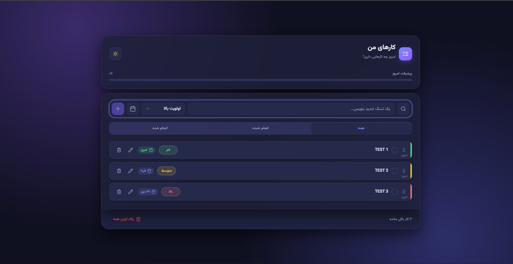

<div align="center">


<p><b>A modern, fast and beautiful task manager with a Persian (RTL) interface</b></p>

<p>
  
  
  
  
</p>

<p>
  
  
  
  
</p>

<p>
  <a href="https://1887-mehdi.github.io/TodoApp/"></a>
  <a href="https://github.com/1887-mehdi/TodoApp/issues"></a>
  <a href="https://github.com/1887-mehdi/TodoApp/issues"></a>
</p>

</div>

<br>

<div align="center">

<a href="#-preview"></a>
<a href="#-features"></a>
<a href="#-tech-stack"></a>
<a href="#-getting-started"></a>
<a href="#-project-structure"></a>
<a href="#-architecture"></a>
<a href="#-license"></a>

</div>

## 📸 Preview

<div align="center">
  
  <br><br>
  <i>Dark theme with progress tracking, priorities, and due dates</i>
</div>

---

## ✨ Features

| | Feature | Description |
|---|---|---|
| ➕ | **Quick add** | Add a task in seconds with priority and due date |
| ✏️ | **Full editing** | Edit title, description, priority, and due date in a modal |
| ✔️ | **Mark as done** | Complete tasks and track what's left |
| 🔍 | **Search** | Instantly search through all your tasks |
| 🎯 | **Priorities** | Low, medium, and high priority levels |
| 📅 | **Due dates** | Built-in date picker for deadlines |
| 📊 | **Progress bar** | See your daily progress at a glance |
| 🗂️ | **Filters** | View all, active, or completed tasks |
| 🖱️ | **Drag & drop** | Reorder tasks by dragging |
| 🌗 | **Light / Dark theme** | Switch themes with a single click |
| 💾 | **Auto-save** | Tasks are stored in your browser (localStorage) |
| 🌐 | **RTL support** | Persian (Farsi) interface with Vazirmatn font |
| 📱 | **Responsive** | Works on desktop, tablet, and mobile |

---

## 🛠️ Tech Stack

<div align="center">

| Technology | Purpose |
|---|---|
| **HTML5** | Semantic page structure |
| **CSS3** | Design tokens, layout, and components |
| **JavaScript (ES Modules)** | Vanilla JS, no frameworks |
| **Bootstrap 5 (RTL)** | Layout and edit modal |
| **Bootstrap Icons** | Icons |
| **Vazirmatn** | Persian font (self-hosted) |

</div>

---

## 🚀 Getting Started

No build step or installation needed.

**1. Clone the repository**

```bash
git clone https://github.com/1887-mehdi/TodoApp.git
cd TodoApp
```

**2. Run the project**

Since the project uses ES Modules, open it with a local server (opening `index.html` directly may be blocked by the browser):

```bash
# Option 1: VS Code → install "Live Server" extension → Right click index.html → Open with Live Server

# Option 2: Python
python -m http.server 8000

# Option 3: Node
npx serve
```

Then visit `http://localhost:8000` (or the address your server shows).

---

## 📂 Project Structure

```
TodoApp/
├── index.html
├── Screenshot.png
├── fonts/
│   └── vazirmatn/            # Self-hosted variable font
├── vendor/
│   ├── bootstrap/            # Bootstrap RTL (CSS + JS)
│   └── bootstrap-icons/      # Icon font
├── css/
│   ├── main.css              # Entry point (@import only)
│   ├── base/                 # Fonts, design tokens, reset
│   ├── layout/               # Header, body, footer, responsive
│   └── components/           # Button, form, filters, modal, toast...
└── js/
    ├── main.js               # Composition root
    ├── core/                 # Constants, DOM, storage, state
    ├── components/           # Todo item/list, modal, toast, drag & drop, date picker
    └── utils/                # Helper functions
```

---

## 🧩 Architecture

The project follows a clean, modular structure:

- **Design tokens** in CSS variables make theming (light/dark) simple and consistent.
- **Component-based CSS and JS** keep every piece small, reusable, and easy to maintain.
- **`main.js` as composition root** wires all modules together in one place.
- **Central state + storage layer** separates data logic from the UI.

---

## 🤝 Contributing

Contributions are welcome and appreciated!

1. Fork the project
2. Create your feature branch: `git checkout -b feature/AmazingFeature`
3. Commit your changes: `git commit -m "Add AmazingFeature"`
4. Push to the branch: `git push origin feature/AmazingFeature`
5. Open a Pull Request

---

## 📄 License

Distributed under the MIT License. See [`LICENSE`](LICENSE) for more information.

---

## 👤 Author

<div align="center">

**Mehdi**

[](https://github.com/1887-mehdi)

<br>

⭐ **If you like this project, give it a star!** ⭐

</div>
